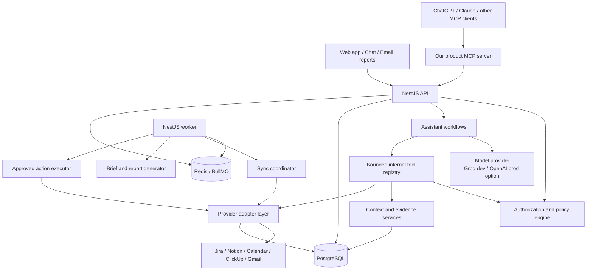
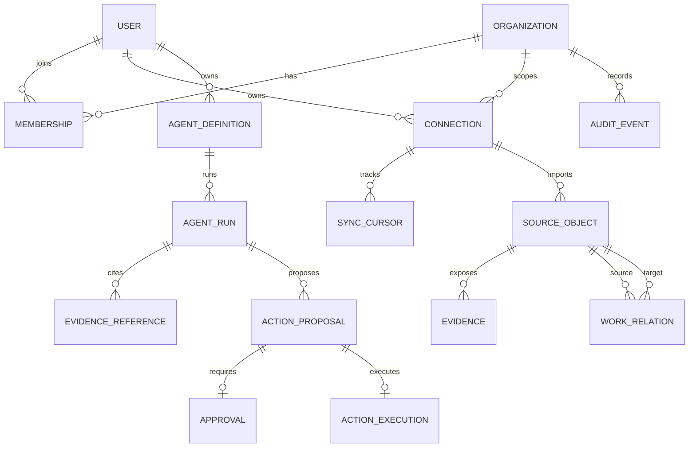
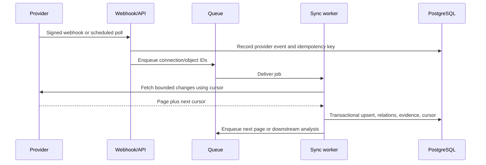
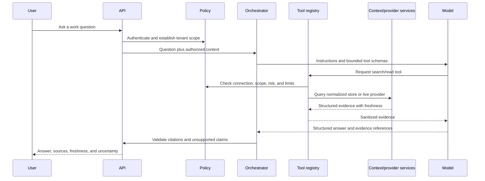
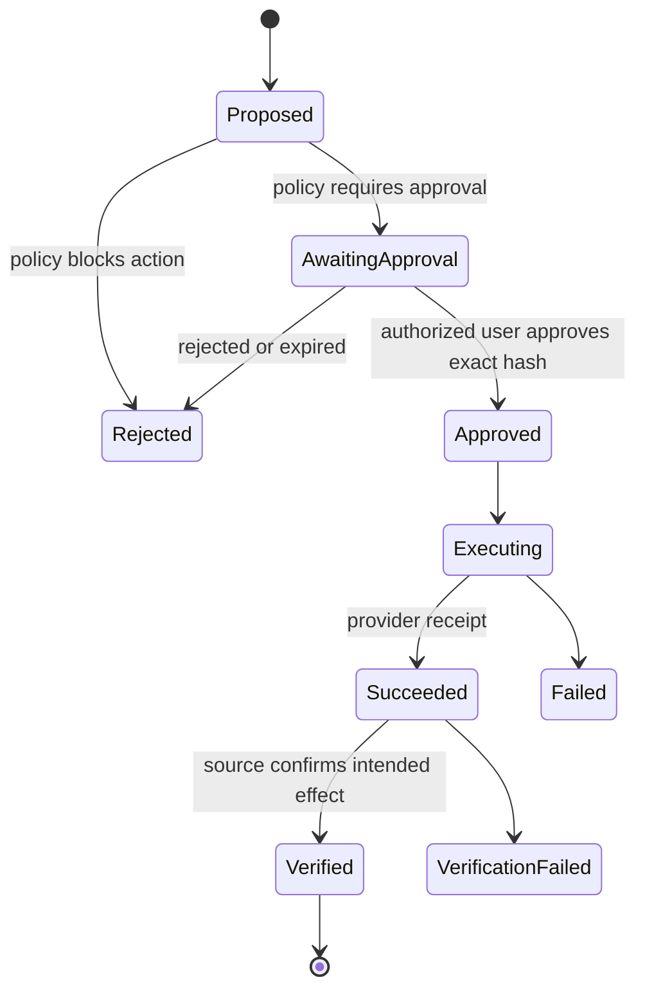

# AI Work Operating System - Implementation Architecture

Status: Verified implementation baseline  
Date: 18 July 2026

Verification scope: Cross-checked on 18 July 2026 against current official documentation for Atlassian/Jira, ClickUp, Notion, Google Calendar, Gmail, OpenAI, and Groq. Preview features and provider limits must be rechecked before each production release.

## 1. Product boundary

This product is not primarily a chatbot. It is a persistent work control plane that:

1. Connects to workplace systems with the user's existing permissions.
2. Builds an evidence-backed model of work, commitments, decisions, dependencies, and risks.
3. Reconciles signals across sources and explains what matters.
4. Proposes actions and routes them through organization policy and human approval.
5. Executes approved actions and verifies the result at the source.

Chat, dashboards, email reports, and third-party assistants are interfaces to this platform. The durable work graph, policy, workflow state, evidence, and audit history are the product.

## 2. Architecture decisions

| Decision | Baseline | Reason |
|---|---|---|
| Deployment shape | Modular NestJS monolith plus separate worker process | Fastest safe MVP; module boundaries can become services later |
| Primary database | PostgreSQL | Transactions, tenancy, workflow state, full-text search, and JSON metadata |
| Background jobs | Redis plus BullMQ | Scheduled briefs, sync, retries, rate-limit handling, and delayed verification |
| Provider access | REST/webhooks for durable sync; MCP or REST for bounded live reads | Sync must be replayable; live questions benefit from model-selected tools |
| Hosted remote MCP | Opt-in after security and data-processing review | The inference vendor may handle MCP credentials and tool payloads even when credentials are not visible in model text |
| AI integration | Internal `ModelProvider` contract using an OpenAI-compatible client | Groq can be used in development and OpenAI can be selected by configuration |
| Retrieval | SQL filters and PostgreSQL full-text search first | Most work questions are scoped by user, project, assignee, status, or time |
| Semantic search | Add embeddings only after evaluation proves a need | Avoid premature infrastructure and cross-tenant retrieval risk |
| Agent topology | One orchestrator initially | Easier to evaluate, secure, and debug than a hierarchy of agents |
| External writes | Propose -> approve -> execute -> verify | Prevents silent or unintended side effects |
| Connections | Personally owned in the MVP | Mirrors provider permissions and simplifies privacy boundaries |

## 3. System view



OAuth credentials must never appear in prompts, model-visible tool arguments, logs, or agent state. By default, our connector layer should call provider REST APIs or act as the MCP client so credentials remain under our control. If OpenAI- or Groq-hosted remote MCP orchestration is enabled, credentials are sent separately to that inference provider for MCP calls; this path therefore requires an explicit security, privacy, residency, and data-processing review. In both paths, the model can request only typed tools, and application handlers enforce tenant checks, scopes, query bounds, approvals, and auditing.

## 4. Runtime components

### API process

Owns synchronous requests:

- Authentication, sessions, organizations, and memberships
- OAuth connection lifecycle
- Connection health and user preferences
- Assistant questions and streaming responses
- Brief retrieval
- Action preview and approval
- Product MCP endpoint for external AI clients

### Worker process

Uses the same NestJS modules, deployed with a worker entry point. It owns:

- Initial and incremental synchronization
- Provider webhook processing
- Scheduled daily and meeting briefs
- Retry and dead-letter handling
- Approved action execution
- Post-action verification
- Retention and purge jobs

Run the API and worker separately in production so slow provider operations cannot consume API capacity.

### PostgreSQL

PostgreSQL is authoritative for identities, connections, normalized context, graph relationships, agent runs, approvals, action receipts, and audit events. Provider records remain authoritative for their native content.

### Redis and BullMQ

Redis is operational infrastructure, not durable product memory. Jobs should contain IDs, not access tokens or full email/document bodies. Important state changes must be persisted in PostgreSQL before a job is acknowledged.

## 5. NestJS module structure

```text
src/
  identity/        organizations, memberships, users, sessions
  connections/     OAuth state, credentials, scopes, connection health
  providers/       common adapter contract and provider implementations
    jira/
    notion/
    google-calendar/
    clickup/
    gmail/
  sync/            jobs, cursors, webhooks, normalization, retries
  context/         work objects, evidence, relationships, search, ranking
  assistant/       ask, briefs, prompts, tool registry, model providers
  agents/          definitions, schedules, run lifecycle, delivery rules
  actions/         proposals, approvals, execution, verification
  policy/          authorization, tool risk, scope and retention rules
  audit/           immutable security and action events
  notifications/   in-app and approval-gated email delivery
  health/          provider, queue, worker, and database health
  prisma/
```

Controllers should call application services. Only repository services should access Prisma directly, and every tenant-owned repository method must require an organization or user scope.

## 6. Core data model



### Identity and tenancy

- `Organization`: tenant and policy boundary.
- `Membership`: user role in an organization (`owner`, `admin`, `member`, `viewer`).
- `User`: login identity.
- `Connection`: provider account authorized by one user; includes organization, granted scopes, status, and encrypted credential reference.
- `OAuthState`: single-use state bound to the initiating user, organization, provider, redirect target, expiry, and PKCE verifier when supported.

### Canonical work graph

Use the name `SourceObject` rather than forcing every item into a task shape.

- Types: `task`, `document`, `message`, `email_thread`, `meeting`, `decision`, `commitment`, `person`, `project`.
- Common fields: provider, native ID, title, summary, native status, normalized status, priority, timestamps, owners, source URL, visibility, content hash, and freshness.
- `WorkRelation`: typed edge such as `blocks`, `depends_on`, `mentions`, `belongs_to`, `decided_in`, `assigned_to`, `follows_up`, or `conflicts_with`.
- `Evidence`: minimal source excerpt and metadata that can support a claim.

Preserve provider-specific data in a limited JSON field, but never make raw payloads the domain model. Avoid retaining full private bodies unless the workflow needs them and policy allows it.

### Agent and action state

- `AgentDefinition`: purpose, schedule/event trigger, allowed tools, delivery audience, model policy, and approval policy.
- `AgentRun`: immutable execution record with status, input window, model usage, evidence, result, and errors.
- `ActionProposal`: exact provider, operation, target, payload hash, preview, risk, expiry, and idempotency key.
- `Approval`: approver, decision, timestamp, and the exact proposal hash approved.
- `ActionExecution`: provider receipt, attempts, final state, and verification evidence.
- `AuditEvent`: deterministic security and product event separate from model traces.

## 7. Provider adapter contract

All provider implementations must sit behind one application contract. MCP and REST are implementation details inside the adapter.

```ts
interface ProviderAdapter {
  provider: ProviderName;

  getCapabilities(connectionId: string): Promise<ProviderCapabilities>;
  validateConnection(connectionId: string): Promise<ConnectionHealth>;

  search(input: BoundedSearch): Promise<EvidencePage>;
  getById(input: ProviderObjectRef): Promise<Evidence>;
  sync(input: SyncRequest): Promise<SyncPage>;

  previewAction(input: ActionRequest): Promise<ActionPreview>;
  executeApprovedAction(input: ApprovedAction): Promise<ActionReceipt>;
  verifyAction(receipt: ActionReceipt): Promise<ActionVerification>;

  revoke(connectionId: string): Promise<void>;
}
```

Every capability declares:

- Required OAuth scopes
- Read, broad-read, draft, write, send, or destructive risk class
- Whether it is available through REST, MCP, or both
- Rate-limit cost and maximum result size
- Whether human approval is always required

### Verified provider compatibility

| Provider | Durable production path | Official MCP status | Architecture implications |
|---|---|---|---|
| Notion | Public OAuth connection, REST API, and signed webhooks | Hosted remote MCP at `https://mcp.notion.com/mcp`; user OAuth with PKCE; no bearer-token or headless authentication | Use REST/webhooks for scheduled agents. MCP is suitable for interactive user sessions. Pin and test a Notion API version. |
| Jira Cloud | OAuth 2.0 3LO, REST API v3/JQL, and dynamic webhooks | Atlassian Rovo MCP is available to Cloud customers; OAuth 2.1 is recommended for interactive use; organization admins control permission groups | Request `offline_access` for rotating refresh tokens. Persist Cloud ID/site grants. Renew OAuth dynamic webhooks before their 30-day expiry. |
| ClickUp | OAuth 2.0, REST API v2, and signed webhooks | Official MCP is public beta and available on all plans; custom clients require OAuth 2.1 with PKCE and ClickUp review/allowlisting | Keep a REST adapter as the production fallback. Capability-discover at runtime and prohibit destructive tools regardless of MCP availability. |
| Google Calendar | OAuth 2.0, Calendar REST API v3, sync tokens, and expiring notification channels | Google remote MCP is Developer Preview | Production MVP uses REST. Preview terms say Pre-GA features must not be included in public applications before GA. |
| Gmail | OAuth 2.0, Gmail REST API, history IDs, and Cloud Pub/Sub notifications | Google remote MCP is Developer Preview | Delay broad production ingestion. `gmail.readonly`, `gmail.compose`, `gmail.modify`, and metadata access are restricted scopes; server storage or transmission of restricted data requires a security assessment. |
| OpenAI | Responses API, function tools, connectors, and remote MCP | Remote MCP supports allowlisted tools and per-call approval policies | Keep our deterministic approval record even if hosted MCP approval is used; application audit state must not depend on one model provider. |
| Groq | OpenAI-compatible client endpoint and application-managed state | Remote MCP and Responses API are beta | Good development option, but Groq does not support `previous_response_id`, `store`, reusable prompts, and several other Responses fields. Always retain conversation and workflow state in our database. |

Provider documentation can contradict itself during previews. For example, ClickUp's MCP setup FAQ says deletion tools are unavailable while its current supported-tools page lists `Delete task`. The architecture must treat runtime tool discovery as descriptive, not authoritative: our policy registry is the final authority and destructive tools remain disabled.

### Current repository compatibility finding

The existing Notion OAuth service sends `Notion-Version: 2022-06-28`. Current Notion documentation identifies `2026-03-11` as the latest version and documents breaking changes around databases and data sources. Do not change the header alone. Add recorded fixtures and migrate the adapter deliberately using Notion's version upgrade guide before implementing reads.

## 8. Synchronization design



Rules:

- Initial sync is bounded by source selection and time window.
- Incremental sync uses provider cursors, update timestamps, history IDs, sync tokens, or webhooks.
- Store an idempotency key for every webhook and action.
- Update normalized objects and the cursor in one database transaction where practical.
- Tombstone deleted or inaccessible objects; do not silently retain them as current truth.
- Expose `lastSuccessfulSyncAt`, lag, errors, and reauthorization status to the user.
- Back off on `429` and transient errors; move exhausted jobs to a dead-letter queue.
- Jira OAuth dynamic webhooks expire after 30 days and need a renewal job; verify their signed bearer token before accepting an event.
- Notion webhooks are change signals, not complete updated objects; verify `X-Notion-Signature`, deduplicate deliveries, then retrieve the current object through the API.
- ClickUp webhooks are tied to the authorizing user; verify the per-webhook signature and use provider history/webhook IDs for idempotency.
- Google Calendar notification channels expire and cannot be renewed in place. Validate the channel ID/token/resource ID, create a replacement channel before expiry, and use `syncToken`; a `410 Gone` requires a bounded full resync.
- Gmail notifications arrive through Cloud Pub/Sub and contain a mailbox history ID rather than message content. Renew each mailbox `watch` at least every seven days (daily is recommended), call `history.list`, and perform a bounded full sync after an invalid or expired history ID (`404`).

## 9. Assistant and retrieval flow



Retrieval order:

1. Resolve user, organization, enabled sources, and question boundaries.
2. Query fresh normalized context with structured filters and full-text search.
3. Use a bounded live provider read when freshness is insufficient or the object is absent.
4. Give the model evidence, never unrestricted database or provider access.
5. Require a structured response with claims mapped to evidence IDs.
6. Reject or label claims that lack evidence; clearly mark inference and uncertainty.

The initial model interface should support `generateStructured`, `stream`, and `toolLoop`. Provider-specific features must not leak into assistant workflows.

## 10. Agents, autonomy, and decisions

Agents are durable workflows, not unrestricted background chat sessions.

### Autonomy levels

| Level | Capability | MVP policy |
|---|---|---|
| 0 | Observe and summarize | Automatic within authorized read scope |
| 1 | Recommend a next action | Automatic, must include reasoning and evidence |
| 2 | Create a draft | Automatic if it has no external side effect |
| 3 | Execute a reversible write | Explicit approval for the exact target and payload |
| 4 | Send communications or make consequential changes | Explicit approval; optional organization policy later |
| 5 | Destructive, financial, legal, HR, or permission changes | Prohibited initially |

An agent may make an internal recommendation such as "this work is likely delayed." It must not present that inference as a source fact. It may choose which authorized read tool to call. It must not decide to send email, modify a ticket, invite attendees, or change a deadline without satisfying the applicable approval policy.

### Action state machine



Never treat a model statement that an action succeeded as proof. Success requires a provider receipt and, for important operations, a follow-up read.

## 11. Scheduled reports and email delivery

An agent can generate and email reports, but reading permission and sending permission are different grants.

Report workflow:

1. Scheduler creates an `AgentRun` for the configured organization, user, time window, and sources.
2. Worker retrieves only evidence visible to the report owner.
3. Report generator creates structured sections and evidence links.
4. Policy engine filters content for the intended recipients. A recipient must not receive data merely because the agent owner could read it.
5. The system stores the rendered report and delivery decision.
6. Email is sent only under an explicit delivery policy. Early versions should require approval or restrict delivery to the requesting user's verified address.
7. Provider receipt and delivery status are audited.

Do not email private Gmail content or private document excerpts to a team distribution list without a separate sharing policy.

## 12. Security requirements

These are release gates, not future enhancements:

- Add `organizationId` and `userId` ownership to all tenant data.
- Guard every user, connection, assistant, and action endpoint.
- Encrypt provider access and refresh tokens with envelope encryption or a managed secret vault.
- Do not store access tokens inside raw OAuth JSON.
- Bind OAuth state to user, organization, provider, redirect, expiry, and PKCE where supported.
- Treat messages, documents, tickets, and tool results as untrusted content that cannot change system instructions or policy.
- Allowlist tools per workflow and cap query windows, result counts, tokens, and execution time.
- Redact secrets and sensitive source bodies from logs and model traces.
- Treat every remote MCP server as a separate data recipient and trust boundary. Only connect to official or reviewed endpoints, use explicit `allowed_tools`, and require approval for write-capable tools.
- For OpenAI Agents SDK deployments using a non-OpenAI model endpoint, configure tracing deliberately: tracing is enabled by default in supported server runtimes and otherwise exports using an OpenAI key. Disable it or use a reviewed exporter with sensitive model/tool logging disabled.
- Record every connection change, broad read, approval, external write, and purge.
- Support disconnect, token revocation, retention expiry, and user-requested purge.
- Test with two users and hostile IDs to prove cross-tenant isolation.

## 13. API surface

```text
POST   /auth/signup
POST   /auth/login
POST   /auth/refresh
GET    /auth/me

GET    /connections
POST   /connections/:provider/authorize
GET    /connections/:provider/callback
POST   /connections/:id/sync
DELETE /connections/:id

POST   /assistant/ask
POST   /assistant/briefs
GET    /assistant/runs/:id
GET    /briefs/:id

GET    /agents
POST   /agents
PATCH  /agents/:id
POST   /agents/:id/run
GET    /agents/:id/runs

POST   /actions/proposals
GET    /actions/:id
POST   /actions/:id/approve
POST   /actions/:id/reject

POST   /webhooks/:provider
GET    /health
GET    /connections/:id/health
```

Use asynchronous `202 Accepted` responses for sync, long assistant workflows, report generation, and action execution. Return a run ID that can be polled or streamed.

## 14. Product MCP server

Expose this product to ChatGPT, Claude, and other compatible clients through a narrow MCP server. This makes those products distribution channels while our system remains the source of organizational context and control.

Initial read tools:

- `get_daily_brief`
- `search_work_context`
- `get_project_risks`
- `get_commitments`
- `get_agent_run`
- `list_pending_approvals`

Initial action tools:

- `draft_email`
- `draft_task_update`
- `approve_action`

MCP requests must authenticate the product user and pass through the same policy, evidence, approval, and audit services as the first-party UI. Do not expose provider tokens or proxy arbitrary provider operations.

Implement the product MCP server using Streamable HTTP and OAuth 2.1 authorization-code flow with PKCE for user-facing clients. Support standards-based protected-resource and authorization-server metadata discovery. Client acceptance is still product-specific: some vendors maintain redirect-URI allowlists or require custom-client review, so compatibility with ChatGPT, Claude, ClickUp, or another client must be tested rather than inferred from protocol support alone.

## 15. MVP scope

Build one complete loop:

> Connect Notion, one task provider, and Google Calendar; synchronize bounded context; generate a source-linked daily brief; answer follow-up questions; draft one action; approve it; execute it; verify it.

Recommended first providers:

1. Notion, because OAuth work has already started.
2. Jira if the demo organization uses Jira; otherwise choose ClickUp, not both.
3. Google Calendar for time-sensitive briefs and meeting preparation.
4. Gmail only after retention, restricted-scope, and recipient-sharing controls are defined.

The first approved write should be a low-risk Jira/ClickUp comment or status update. Email sending has a larger privacy and impersonation risk and should come later.

## 16. Delivery plan

### Phase 0 - Secure the foundation

- Add organizations, memberships, user-owned connections, and user-bound OAuth state.
- Encrypt tokens and sanitize existing raw OAuth storage.
- Guard routes and introduce tenant-scoped repositories.
- Add authorization and OAuth account-mix-up tests.

Exit: two users cannot see, use, disconnect, or retrieve each other's connections or context.

### Phase 1 - Establish the context platform

- Implement the provider contract.
- Finish Notion search/read.
- Add Jira or ClickUp reads.
- Add `SourceObject`, `WorkRelation`, `Evidence`, and `SyncCursor`.
- Implement manual bounded synchronization and full-text search.

Exit: a user can search real project context and every result links to its source.

### Phase 2 - Build the assistant loop

- Add the configurable model provider layer with Groq for development.
- Implement structured daily briefs and assistant questions.
- Add the tool registry, evidence validator, run records, and evaluation dataset.
- Label freshness, unavailable sources, facts, and inferences.

Exit: the daily brief contains no unsupported priorities or blockers.

### Phase 3 - Add time and reliability

- Add Google Calendar.
- Add Redis/BullMQ, scheduled jobs, cursor sync, retries, dead-letter handling, and provider health.
- Generate meeting preparation briefs.

Exit: briefs remain usable when one source fails and clearly report staleness.

### Phase 4 - Add controlled action

- Implement proposal, preview, approval, execution, and verification records.
- Start with one reversible task-provider write.
- Add audit and idempotency tests.

Exit: no write can run without the exact required approval, and every result has a provider receipt.

### Phase 5 - Agents and distribution

- Add saved agent definitions, triggers, schedules, and delivery policy.
- Add approved email report delivery.
- Expose high-value product tools through our MCP server.

Exit: a scheduled agent produces an evidence-backed report for an authorized audience with a complete audit trail.

## 17. Decisions required before implementation

The recommended defaults are recorded below so implementation can start:

| Question | Default decision |
|---|---|
| First task provider | Jira, unless the actual demo workspace uses ClickUp |
| Tenant model | Organization plus memberships; integrations personally owned |
| Source retention | Normalized metadata/evidence retained; sensitive bodies minimized and policy-limited |
| First write | Approval-gated task comment or status update |
| Model strategy | Groq through OpenAI-compatible SDK in development; configurable provider in all environments |
| Agent strategy | One orchestrator; scheduled workflows reuse the same tools and policy engine |
| Search | PostgreSQL structured filters and full-text search; evaluate embeddings later |
| Deployment | API, worker, PostgreSQL, and Redis; no microservices for MVP |

Change these through short architecture decision records rather than allowing provider-specific code to decide them implicitly.

## 18. Success measures

- Evidence coverage: percentage of material claims linked to valid evidence.
- Unsupported-claim rate: material claims with no supporting source.
- Freshness: age of the newest successful sync per enabled provider.
- Action safety: unapproved execution attempts blocked; duplicate writes prevented.
- Time to first useful brief after connection.
- User correction rate for priorities, owners, deadlines, and inferred risks.
- Provider success rate, `429` rate, retry count, and dead-letter count.
- Model and provider cost per generated brief and per active user.

## 19. Verification record and official references

The following design claims were verified from official sources on 18 July 2026:

- **Confirmed:** The hybrid API/webhook plus MCP strategy matches provider maturity. REST APIs expose deterministic pagination, cursors, and webhook/push mechanisms; MCP is strongest for interactive tool use.
- **Confirmed:** OpenAI and Groq both support remote MCP approval configuration, but our persisted proposal/approval/execution state remains necessary for provider independence and auditability.
- **Confirmed:** Groq can use OpenAI client libraries by changing the base URL and key, but its Responses API and remote MCP are beta and it lacks OpenAI server-side conversation-state features.
- **Confirmed:** Personal connection ownership matches Jira, ClickUp, Notion MCP, Calendar, and Gmail delegated-permission behavior.
- **Corrected:** Google Workspace MCP is Developer Preview and is not a public-production dependency.
- **Corrected:** Remote MCP authentication is not equivalent to keeping tokens inside our backend; hosted orchestration creates an additional credential/data processor boundary.
- **Corrected:** Provider notifications are not one uniform signed-webhook abstraction. Gmail uses Pub/Sub, Calendar uses expiring channels, Jira OAuth webhooks use signed bearer authentication, and Notion/ClickUp use provider-specific signatures.
- **Corrected:** The repository's pinned Notion API version is old and requires a tested migration before Notion reads are implemented.
- **Open risk:** ClickUp's official MCP pages currently disagree about delete-tool availability. Destructive capability stays prohibited and runtime contract tests are required.

Official references:

- [OpenAI MCP and connectors](https://developers.openai.com/api/docs/guides/tools-connectors-mcp)
- [OpenAI Agents SDK model providers](https://openai.github.io/openai-agents-js/guides/models/)
- [OpenAI Agents SDK configuration and tracing](https://openai.github.io/openai-agents-js/guides/config/)
- [Groq OpenAI compatibility](https://console.groq.com/docs/openai)
- [Groq Responses API](https://console.groq.com/docs/responses-api)
- [Groq remote MCP](https://console.groq.com/docs/tool-use/remote-mcp)
- [Atlassian Rovo MCP supported tools](https://developer.atlassian.com/cloud/rovo-mcp/guides/supported-tools/)
- [Atlassian Rovo MCP OAuth 2.1](https://developer.atlassian.com/cloud/rovo-mcp/guides/configuring-oauth-2-1/)
- [Jira OAuth 2.0 3LO](https://developer.atlassian.com/cloud/jira/platform/oauth-2-3lo-apps/)
- [Jira JQL issue search](https://developer.atlassian.com/cloud/jira/platform/rest/v3/api-group-issue-search/)
- [Jira dynamic webhooks](https://developer.atlassian.com/cloud/jira/software/webhooks/)
- [ClickUp MCP setup, limits, and client requirements](https://developer.clickup.com/docs/connect-an-ai-assistant-to-clickups-mcp-server)
- [ClickUp MCP supported tools](https://developer.clickup.com/docs/mcp-tools)
- [ClickUp API authentication](https://developer.clickup.com/docs/authentication)
- [ClickUp webhooks](https://developer.clickup.com/docs/webhooks)
- [ClickUp API rate limits](https://developer.clickup.com/docs/rate-limits)
- [Notion hosted MCP](https://developers.notion.com/guides/mcp/overview)
- [Notion custom MCP client OAuth](https://developers.notion.com/guides/mcp/build-mcp-client)
- [Notion OAuth authorization](https://developers.notion.com/guides/get-started/authorization)
- [Notion API versioning](https://developers.notion.com/reference/versioning)
- [Notion webhooks](https://developers.notion.com/reference/webhooks)
- [Notion search limitations](https://developers.notion.com/reference/search-optimizations-and-limitations)
- [Google Workspace Developer Preview](https://developers.google.com/workspace/preview)
- [Google Workspace MCP configuration](https://developers.google.com/workspace/guides/configure-mcp-servers)
- [Google Calendar OAuth scopes](https://developers.google.com/workspace/calendar/api/auth)
- [Google Calendar incremental synchronization](https://developers.google.com/workspace/calendar/api/guides/sync)
- [Google Calendar push channels](https://developers.google.com/workspace/calendar/api/guides/push)
- [Gmail OAuth scopes](https://developers.google.com/workspace/gmail/api/auth/scopes)
- [Gmail history synchronization](https://developers.google.com/workspace/gmail/api/reference/rest/v1/users.history/list)
- [Gmail Pub/Sub push notifications](https://developers.google.com/workspace/gmail/api/guides/push)
